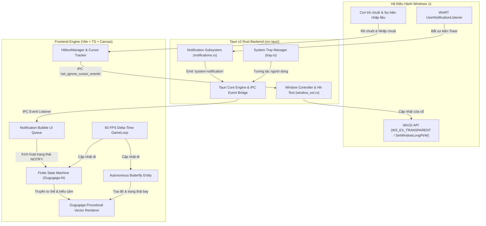

# Kiến Trúc Hệ Thống MyPet (System Architecture)

Tài liệu này mô tả chi tiết kiến trúc kỹ thuật của ứng dụng **MyPet** (nhân vật Gugugaga) trên nền tảng Windows 11, kết hợp giữa backend Rust native hiệu năng cao và frontend WebView2/Canvas 60 FPS.

---

## 1. Sơ Đồ Khối Tổng Thể (High-Level Architecture)

---

## 2. Các Thành Phần Cốt Lõi

### 2.1. Cửa Sổ Trong Suốt & Cơ Chế Dynamic Click-Through
- **Vấn đề cần giải quyết:** Desktop Pet cần hiển thị tự do trên toàn bộ màn hình hoặc khu vực taskbar nhưng không được chặn các thao tác click của người dùng vào các ứng dụng bên dưới (trình duyệt, IDE, game, tài liệu).
- **Giải pháp:**
  - Cửa sổ Tauri được cấu hình `transparent: true`, `decorations: false`, `alwaysOnTop: true`, `skipTaskbar: true`.
  - Frontend theo dõi tọa độ con trỏ chuột thời gian thực thông qua sự kiện `pointermove` / `mousemove`.
  - **Hitbox Logic:**
    1. Kiểm tra bounding box của Gugugaga và các phần tử UI tương tác (bong bóng thoại, menu ngữ cảnh).
    2. Nếu con trỏ chuột nằm trong hitbox, frontend gọi lệnh IPC `set_ignore_cursor_events(false)` -> Cửa sổ nhận tương tác chuột để kéo thả, click, mở menu.
    3. Khi con trỏ chuột rời khỏi hitbox, frontend gọi lệnh IPC `set_ignore_cursor_events(true)` -> Cửa sổ lập tức kích hoạt cờ `WS_EX_TRANSPARENT` trong Win32 API, cho phép toàn bộ cú click xuyên qua màn hình đến ứng dụng bên dưới.
    4. Thêm vùng đệm (padding) 10-15px xung quanh hitbox để tránh hiện tượng rung lắc/flicker khi di chuột ở mép.

### 2.2. Vòng Lặp Render 60 FPS (GameLoop) & Vật Lý Nội Suy
- **Vòng lặp:** Sử dụng `requestAnimationFrame` kết hợp tính toán thời gian trôi qua `dt = (currentTime - lastTime) / 1000`.
- **Giới hạn tốc độ (Frame Clamping):** Khóa `dt` tối đa ở mức `0.05s` (20 FPS tương đương) để ngăn chặn hiện tượng nhảy vọt tọa độ (physics tunneling) khi ứng dụng bị thu nhỏ hoặc tải nặng.
- **Mô hình vật lý:**
  - Vị trí: $\vec{P}_{t} = \vec{P}_{t-1} + \vec{V} \cdot dt$
  - Trọng lực: $\vec{V}_y = \vec{V}_y + g \cdot dt$ ($g = 1800\,px/s^2$)
  - Lực cản không khí & ma sát: Giảm dần vận tốc theo hệ số suy hao $k = 0.92$.
  - Va chạm sàn: Tọa độ $Y_{ground} = H_{screen} - H_{pet} - H_{taskbar}$.

### 2.3. Trình Vẽ Procedural Vector (Canvas 2D)
- Thay vì phụ thuộc vào các sprite sheet tĩnh dễ bị mờ hoặc gãy liên kết, `GugugagaRenderer` sử dụng đồ họa vector động trên HTML5 Canvas:
  - **Squash & Stretch:** Biến dạng hình elip cơ thể khi nhảy, tiếp đất hoặc bị nhấc lên.
  - **Cơ chế nhấp nháy mắt & chuyển động đồng tử:** Tạo cảm xúc tự nhiên, mắt nhìn theo hướng di chuyển hoặc nhìn theo bướm.
  - **Tai thỏ / ăng-ten lắc lư (Secondary Motion):** Tính toán dao động đàn hồi dựa trên quán tính di chuyển.
  - **Hệ thống hạt (Particle System):** Hiệu ứng bụi chân khi chạy, sao lấp lánh khi bắt được bướm, và chữ "Zzz" khi ngủ.

### 2.4. Rust WinRT Subsystem (Lắng Nghe Thông Báo Windows 11)
- Sử dụng crate `windows` với feature `UI_Notifications_Management`:
  - Lớp `UserNotificationListener::Current()` yêu cầu quyền truy cập thông báo hệ thống.
  - Phương thức `GetNotificationsAsync` lấy danh sách thông báo mới nhất.
  - Đăng ký bộ lắng nghe sự kiện `NotificationChanged` để nhận thông báo tức thời.
  - Khi có thông báo mới, bóc tách `app_name`, `title`, `body` từ `NotificationBinding.GetTextElements()`.
  - Chuyển tiếp dữ liệu qua kênh IPC Tauri Event `"system-notification"`.
  - Cung cấp phương thức Mock IPC `trigger_custom_notification` để hỗ trợ môi trường thử nghiệm độc lập.

---

## 3. Tối Ưu Hóa Bộ Nhớ & Hiệu Năng (Legion 5 Pro / 16GB RAM)
1. **WebView2 Memory Optimization:**
   - Không nạp các thư viện CSS nặng hoặc framework giao diện cồng kềnh; giao diện vẽ trực tiếp lên một `<canvas>` duy nhất và DOM tối thiểu cho bong bóng thoại.
   - Sử dụng `will-change: transform` cho lớp overlay.
2. **Rust Runtime:**
   - Sử dụng tokio thread pool bất đồng bộ, không khóa luồng giao diện chính.
   - Giải phóng bộ đệm thông báo ngay sau khi đẩy sang frontend.
