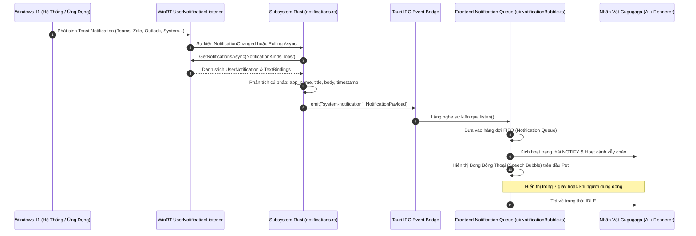

# Giao Thức Lắng Nghe & Hiển Thị Thông Báo Windows 11 (Notification Protocol)

Tài liệu này định nghĩa giao thức thu nhận thông báo từ hệ điều hành Windows 11 qua WinRT API, chuyển giao qua Tauri IPC Bridge và cơ chế hiển thị trên giao diện người dùng.

---

## 1. Luồng Hoạt Động (Notification Pipeline)



---

## 2. Đặc Tả Dữ Liệu (Data Structures)

### 2.1. Cấu Trúc Payload Thông Báo (Rust & TypeScript)

```typescript
export interface NotificationPayload {
  id: string;               // Mã định danh duy nhất (UUID hoặc ID từ WinRT)
  appName: string;          // Tên ứng dụng phát thông báo (ví dụ: "Google Chrome", "Zalo", "Slack")
  title: string;            // Tiêu đề thông báo
  body: string;             // Nội dung chi tiết thông báo
  timestamp: number;        // Dấu thời gian Unix timestamp (milliseconds)
  priority?: "low" | "normal" | "high"; // Mức độ ưu tiên
}
```

```rust
#[derive(serde::Serialize, serde::Deserialize, Clone, Debug)]
pub struct NotificationPayload {
    pub id: String,
    pub app_name: String,
    pub title: String,
    pub body: String,
    pub timestamp: u64,
    pub priority: Option<String>,
}
```

---

## 3. Kiến Trúc Backend Rust (`notifications.rs`)

### 3.1. Truy Cập WinRT API
- Sử dụng module `windows::UI::Notifications::Management::UserNotificationListener`.
- Quy trình yêu cầu quyền hệ thống:
  ```rust
  let listener = UserNotificationListener::Current()?;
  let access_status = listener.RequestAccessAsync()?.get()?;
  // Kiểm tra access_status == UserNotificationListenerAccessStatus::Allowed
  ```
- Lắng nghe thay đổi bằng `NotificationChanged` event token hoặc vòng lặp giám sát định kỳ (Polling Loop) với chu kỳ 1.5s để đảm bảo tương thích ổn định tuyệt đối trên mọi bản dựng Windows 11.

### 3.2. Cơ Chế Fallback & Kiểm Thử Chủ Động (Mock Generator & IPC)
- Để đảm bảo ứng dụng luôn chạy mượt mà ngay cả khi người dùng chưa cấp quyền thông báo trong Windows Settings (`System > Notifications`):
  - **Lệnh IPC:** `trigger_custom_notification(payload: NotificationPayload)`.
  - Có thể kích hoạt bất kỳ lúc nào từ:
    1. Menu ngữ cảnh khay hệ thống (System Tray -> "Gửi thông báo kiểm thử").
    2. Menu chuột phải trên thân Gugugaga.
    3. Phím tắt hoặc console kiểm thử.
  - Tự động sinh nội dung mẫu phong phú: `"Zalo: Bạn có tin nhắn mới từ Đồng Nghiệp"`, `"GitHub: Pull Request #42 merged"`, `"Pin: Pin laptop còn 20%"`.

---

## 4. Cơ Chế Hàng Đợi Giao Diện (Speech Bubble Queue)

1. **Quản lý hàng đợi (FIFO Queue):**
   - Nếu nhiều thông báo đến cùng lúc, thông báo mới sẽ xếp hàng đợi.
   - Mỗi thông báo hiển thị tối thiểu 6 giây và tối đa 10 giây (tùy theo độ dài chuỗi ký tự).
   - Có nút bấm "X" nhỏ để tắt nhanh, hoặc nhấp vào bong bóng để chuyển sang thông báo tiếp theo.
2. **Neo Tọa Độ Động (Dynamic Anchor):**
   - Tọa độ bong bóng thoại tự động tính toán dựa theo vị trí đầu của Gugugaga:
     $$X_{bubble} = X_{pet} + \frac{W_{pet}}{2} - \frac{W_{bubble}}{2}$$
     $$Y_{bubble} = Y_{pet} - H_{bubble} - 16\,px$$
   - Tự động kẹp biên (boundary clamping) để không bao giờ bị tràn ra ngoài mép màn hình.
3. **Hiệu Ứng Hoạt Họa Anime:**
   - Xuất hiện: Hiệu ứng Pop-up đàn hồi (`spring bounce animation`).
   - Mũi tên trỏ xuống trúng ngay chỏm đầu Gugugaga.
   - Tự động mở rộng hitbox click-through để người dùng có thể nhấp chọn hoặc tương tác với bong bóng.
