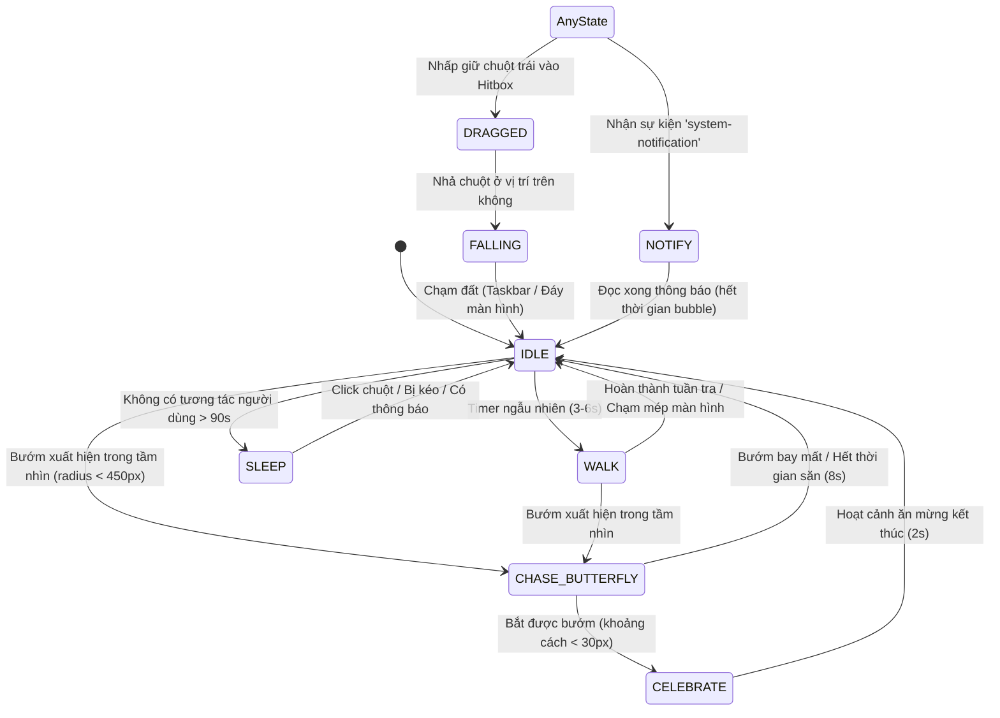

# Thiết Kế Máy Trạng Thái Hữu Hạn (Finite State Machine - FSM)

Tài liệu này định nghĩa cấu trúc máy trạng thái hữu hạn (FSM) quản lý toàn bộ chu kỳ hành vi, phản xạ và hoạt cảnh của nhân vật **Gugugaga**.

---

## 1. Sơ Đồ Chuyển Trạng Thái (State Transition Diagram)

---

## 2. Đặc Tả Từng Trạng Thái Của Gugugaga

### 2.1. Trạng Thái `IDLE` (Đứng Yên / Thở / Quan Sát)
- **Hoạt cảnh:**
  - Nhịp thở nhẹ: Co giãn cơ thể theo chu kỳ $1.5\,Hz$ (squash-and-stretch $\pm 3\%$).
  - Mắt chớp ngẫu nhiên sau mỗi $2 - 5$ giây.
  - Đồng tử mắt di chuyển quan sát con trỏ chuột của người dùng hoặc nhìn ngó xung quanh.
  - Tai lắc lư nhẹ nhàng theo quán tính nhịp thở.
- **Điều kiện thoát:**
  - Timer ngẫu nhiên ($3 - 6$ giây) hết hạn -> chuyển sang `WALK`.
  - Phát hiện bướm (`Butterfly.isActive`) -> chuyển sang `CHASE_BUTTERFLY`.
  - Nhấp giữ chuột trái -> chuyển sang `DRAGGED`.
  - Timer không hoạt động $> 90$ giây -> chuyển sang `SLEEP`.
  - Có thông báo mới từ hệ thống -> chuyển sang `NOTIFY`.

### 2.2. Trạng Thái `WALK` (Đi Dạo / Tuần Tra)
- **Hành vi di chuyển:**
  - Chọn hướng ngẫu nhiên (trái hoặc phải) với vận tốc đi bộ $v_x \in [80, 140]\,px/s$.
  - Khi chạm biên màn hình ($x < 20$ hoặc $x > W_{screen} - 100$), lập tức quay đầu ngược lại.
- **Hoạt cảnh:**
  - Chân bước nhịp nhàng theo chu kỳ bước đi.
  - Thân nhấp nhô hình sin (bouncing walk) tạo cảm giác tràn đầy năng lượng.
  - Bụi hạt li ti (`step particles`) bắn ra sau mỗi bước chạm đất.
- **Thời lượng:** Di chuyển trong khoảng $4 - 8$ giây trước khi dừng lại nghỉ ở `IDLE`.

### 2.3. Trạng Thái `CHASE_BUTTERFLY` (Rượt Bắt Bướm)
- **Kích hoạt:** Bướm xuất hiện và khoảng cách $d = \|\vec{P}_{pet} - \vec{P}_{butterfly}\| < 450\,px$.
- **Hành vi AI:**
  - Tăng tốc chạy ($v_x \in [220, 320]\,px/s$) hướng về tọa độ bướm.
  - Khi đến gần ($d < 120\,px$) và bướm đang bay cao, Gugugaga chuẩn bị lấy đà (squash thân thể xuống $75\%$) rồi nhảy vọt lên không trung ($v_y = -650\,px/s$).
  - Khi khoảng cách $d < 35\,px$, tính là bắt thành công -> chuyển sang hoạt cảnh `CELEBRATE`.
- **Hoạt cảnh `CELEBRATE`:**
  - Nhảy xoay vòng trên không, hai tay giơ cao, mắt hình ngôi sao lấp lánh và hiệu ứng hạt pháo hoa li ti phát ra.
  - Duy trì 2 giây trước khi trở về `IDLE`.

### 2.4. Trạng Thái `SLEEP` (Ngủ Nghỉ Khôi Phục Năng Lượng)
- **Kích hoạt:** Sau 90 giây không có bất kỳ tương tác chuột nào, hoặc kích hoạt thủ công qua System Tray / Context Menu.
- **Hoạt cảnh:**
  - Gugugaga cuộn tròn người, tai cụp xuống, hai mắt nhắm nghiền thành đường cong cong đáng yêu.
  - Phát sinh hạt ký tự `"Z"`, `"Zz"`, `"Zzz"` bay nổi dần lên trên và mờ dần trong không gian.
  - Nhịp thở giãn chậm ($0.5\,Hz$).
- **Đánh thức:** Nhấp chuột vào người, kéo đi, hoặc khi có thông báo Windows xuất hiện.

### 2.5. Trạng Thái `DRAGGED` & `FALLING` (Kéo Thả Vật Lý)
- **Kích hoạt `DRAGGED`:** Người dùng nhấn chuột trái vào vùng thân Gugugaga và di chuyển.
- **Hoạt cảnh `DRAGGED`:**
  - Thân hình bị kéo giãn nhẹ theo hướng chuyển động của chuột.
  - Bốn chân và tai đung đưa theo gia tốc và lực quán tính của chuột (Physics Ragdoll / Secondary Motion).
  - Mắt mở to tròn ngơ ngác, miệng chữ O kinh ngạc.
- **Kích hoạt `FALLING`:** Nhả chuột trái khi vị trí hiện tại nằm trên không ($y < Y_{ground}$).
- **Vật lý `FALLING`:**
  - Rơi tự do với gia tốc trọng lực $g = 1800\,px/s^2$.
  - Tiếp đất (chạm $Y_{ground}$): Gây hiệu ứng nảy nhẹ (rebound damping $e = 0.35$), nén thân (squash) tạo cảm giác va chạm chân thực trước khi đứng dậy vào `IDLE`.

### 2.6. Trạng Thái `NOTIFY` (Báo Hiệu Thông Báo Mới)
- **Kích hoạt:** Nhận sự kiện `system-notification` từ subsystem Rust.
- **Hoạt cảnh:**
  - Cắt ngang trạng thái hiện tại (ngay cả khi đang ngủ hay tuần tra).
  - Nhảy bật lên tại chỗ ($v_y = -400\,px/s$), giơ hai tay vẫy chào và hướng mặt lên trên.
  - Hiển thị bong bóng thoại anime nổi phía trên đỉnh đầu chứa nội dung thông báo.
- **Kết thúc:** Sau thời gian đọc ($6 - 10$ giây tùy độ dài thông báo), bong bóng thu nhỏ biến mất và Gugugaga trở lại `IDLE`.
